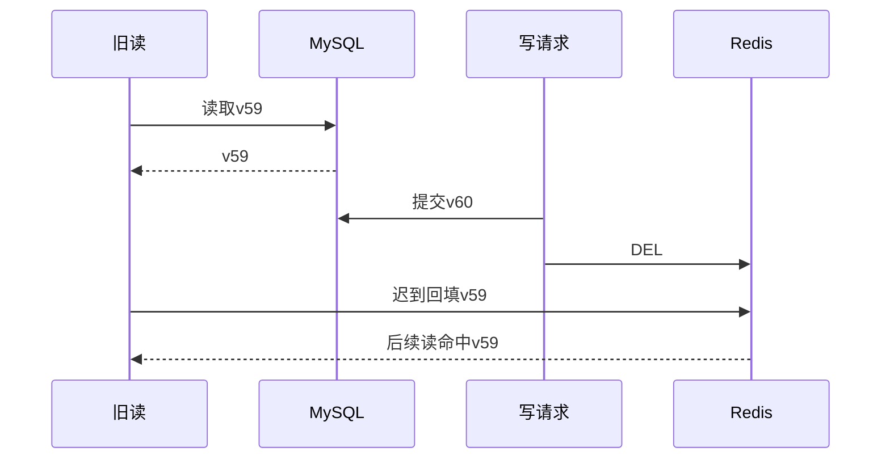

# S1：真实MySQL前的缓存策略对照（2026-10-27）

> 由 Codex 生成。测量源码固定为 `backend-cloud-labs@d2ca677db32a17eaed9aff776244262b88d42801`；后续交接、控制和分析文件独立保存。数据版本：`catalog/b0e5aba50106/seed-20261023/8025233af339`。

本轮实验、有效重复补足、独立校准和证据分析已完成。**没有实测证据支持 B/D 在本负载下带来显著 GET p99 改善。** 主矩阵与反向组的客户端确认口径陈旧读均为0，陈旧率收益记为不确定；同一次有效运行的服务端热点时序仍捕获了真实旧值回填。绕过服务直写时，A/B/D的确认口径陈旧率中位数约27.9%，C观察为0，代价是更高的MySQL回源。

## 1. 数据与控制条件

- P1合成放大的200万商品，独立 `bcl_s1.items`；只读 `items_base` 从已校验的P1 TSV导入。每轮恢复所有尝试写入的ID并核对字段，专用Redis清空、E1重启。共享 `bcl.items` 没有被本实验更新。
- Redis TTL为60秒，读写访问均按固定热度排列上的Zipf(0.99)生成；95:5、99:1两档，100/250/400 req/s三档。重复编号r的种子为20261026+r，同编号各策略使用同一计划。
- 率档由固定源短探测的A基线决定：有效且服务端GET p99≤50ms的最高已探测点为500 req/s，再取25%/50%/80%并按50向下取整、最低100。A1500虽请求成功，服务端p99为122.687ms；A500为28.047ms。50ms是实验阈值，短探测不能充当系统容量认证。C探测保留，未作为定档门槛。
- 每轮只读预建128个连接请求，预热10秒并排空，然后重置直方图；正式窗口 `max(20,ceil(12000/(rate*ratio)))` 秒，预计至少约1.2万次读。五遍交替，奇数A/B/C/D、偶数反序。补跑只由有效性决定，按整组增加重复编号。
- tx四核主机上，E1绑定CPU编号2、内存192MiB，实验Redis绑定CPU编号1、内存192MiB，MySQL绑定CPU编号0、buffer pool 256MiB；商品表约310MiB，超出buffer pool。其他已部署服务仍在，背景负载未完全隔离。实际镜像、内存、内核和客户端快照见[环境记录](measurements/2026-10-27-s1/metadata/environment.json)。
- 主发压器在真实Mac（arm64、10核），四条独立业务SSH流各最多256 HTTP连接，另设管理/旁路SQL控制流；总在途上限1536、旁路SQL池64、超时3秒、客户端空闲连接2秒。旧单隧道、旧版本探测均为诊断数据，不混入正式比较。
- A普通SET回填、写后DEL；B版本门控回填及写后回填；C每次先完整点查源，再校验缓存版本；D在门控缓存优先基础上保留本地修复队列与代际。C当前实现读取完整商品行，不是单独优化过的 `SELECT version`。

## 2. 有效性、重复与统计规则

| 范围 | 完成尝试 | 有效 | 无效 |
| --- | --- | --- | --- |
| Mac主对照（含整组补跑） | 144 | 137 | 7 |
| 反向验证 | 15 | 15 | 0 |
| 直写MySQL | 24 | 23 | 1 |
| 独立剖析 | 3 | 3 | 0 |
| tx校准（单列） | 20 | 20 | 0 |


合计206次已完成尝试、198次有效；用户暂停造成的1次中断另列，未计有效/完成。所有无效结果保持原始标记。暂停前后复用同一源码、二进制、基底和种子规则，时段差异保留在范围内；不把恢复后的链路变化解释为业务优化。

全部已完成尝试发出正式读/写请求2582000次，其中读失败537次、写失败18次，正式丢到达0次；发出请求成功率为99.97851%。这是含无效轮次的质量统计，不是只挑成功轮。CSV错误分类（含预热）为 `{'measured:mysql': 1, 'measured:transport_timeout': 554, 'warmup:transport_timeout': 1}`。预热已发请求失败同样判无效。

有效门禁包含：无失败/正式丢到达、正版本、HdrHistogram不溢出、发率偏差≤5%、指标完整、源最终版本/字段审计通过。运行时source=mysql、策略/关门控/TTL另经原始结果复核。共同有效重复最少为5；若A、B失效的编号不同，就继续补整组。

表内是全部有效尝试的“各运行分位数的中位数 [最小,最大]”；结论使用双方共同有效编号重算，具体文件和编号在[analysis.json](measurements/2026-10-27-s1/analysis.json)。只有相对变化>10%且最小/最大范围不重叠才按实验规则记为显著；零基线的相对提升不可定义。这个规则不是置信区间或p值检验。

客户端延迟从计划到达计到完成，包含排队/调度/链路；服务端从HTTP业务handler入口计到返回。两者都以HdrHistogram(1μs–600s、3位有效数字)记录。回源QPS分母包含实际采集和排空时间，是近似值。Redis命中率不等于免回源率：C即使命中Redis仍读MySQL。

## 3. 主矩阵

### 服务端GET p99，毫秒

| 读比例 | req/s | A | B | C | D |
| --- | --- | --- | --- | --- | --- |
| 95% | 100 | 3.013 [2.761, 3.447] (n=6) | 3.148 [2.751, 5.035] (n=6) | 3.131 [2.827, 5.131] (n=7) | 2.919 [2.733, 4.057] (n=6) |
| 95% | 250 | 8.399 [3.833, 16.559] (n=5) | 3.693 [3.187, 15.479] (n=5) | 10.255 [2.527, 31.807] (n=5) | 9.295 [2.501, 14.335] (n=5) |
| 95% | 400 | 15.031 [8.495, 43.839] (n=6) | 10.743 [5.803, 20.511] (n=5) | 19.719 [11.679, 30.447] (n=6) | 6.885 [2.405, 28.415] (n=6) |
| 99% | 100 | 4.521 [3.107, 5.643] (n=6) | 3.961 [3.123, 6.367] (n=6) | 3.490 [3.041, 8.191] (n=6) | 3.737 [2.763, 4.855] (n=5) |
| 99% | 250 | 7.655 [4.183, 17.887] (n=5) | 5.543 [2.407, 30.911] (n=5) | 15.223 [9.375, 22.255] (n=5) | 7.987 [3.281, 17.407] (n=5) |
| 99% | 400 | 7.475 [2.247, 12.807] (n=5) | 7.215 [2.721, 51.967] (n=7) | 17.615 [2.461, 31.823] (n=7) | 7.239 [2.243, 41.503] (n=7) |

### 客户端GET p99，毫秒

| 读比例 | req/s | A | B | C | D |
| --- | --- | --- | --- | --- | --- |
| 95% | 100 | 362.303 [80.383, 625.151] (n=6) | 532.223 [129.727, 999.423] (n=6) | 444.671 [218.751, 732.159] (n=7) | 231.103 [146.303, 569.855] (n=6) |
| 95% | 250 | 528.383 [275.967, 659.455] (n=5) | 390.399 [333.823, 1044.479] (n=5) | 570.367 [79.487, 1187.839] (n=5) | 664.063 [79.423, 956.415] (n=5) |
| 95% | 400 | 520.319 [323.327, 774.143] (n=6) | 484.351 [223.231, 878.591] (n=5) | 584.191 [335.871, 791.039] (n=6) | 372.735 [126.591, 857.087] (n=6) |
| 99% | 100 | 693.247 [90.751, 1709.055] (n=6) | 537.855 [99.007, 935.423] (n=6) | 519.935 [83.007, 886.271] (n=6) | 549.887 [173.695, 934.911] (n=5) |
| 99% | 250 | 711.167 [482.559, 990.207] (n=5) | 394.239 [194.943, 1266.687] (n=5) | 699.903 [419.071, 968.191] (n=5) | 596.991 [329.471, 1140.735] (n=5) |
| 99% | 400 | 425.727 [82.943, 1676.287] (n=5) | 352.255 [94.463, 1377.279] (n=7) | 590.847 [69.695, 1649.663] (n=7) | 466.687 [71.743, 1140.735] (n=7) |

18个主矩阵策略相对A的服务端p99比较、18个客户端p99比较均未通过上述区分判据；不能仅凭较低中位数写提升百分比。主矩阵全部有效轮的确认口径陈旧读为0，因此18个陈旧率比较均记为不确定。B和D回源量相对A变化未超过预定判据；C的配对中位数回源高出约66.8%–93.4%，六个条件均达到区分判据。

完整p50/p95/p99、命中率、成功率及每次运行值见[汇总CSV](measurements/2026-10-27-s1/groups.csv)、[质量CSV](measurements/2026-10-27-s1/quality.csv)和原始文件。例：95:5、400 req/s各组的回源中位数约A203.7、B193.9、C378.0、D193.4 QPS。B/D的写后回填可以避免部分写后未命中，但此数据不足以支持大幅降低回源或p99的主张。

## 4. 热点竞态与反向验证

有效运行 [S1-A-p95-q400-r1](measurements/2026-10-27-s1/matrix-idle-2026-10-27/S1-A-p95-q400-r1.trace.jsonl.gz)，热点1851455，捕获了下列同进程单调时间序列（单位ns）：

| 操作 | 事件 | 版本 | t_ns |
| --- | --- | --- | --- |
| 读962 | begin | — | 40871928973 |
| 读962 | store_read | 59 | 40922999828 |
| 写975 | write_commit | 60 | 40932488897 |
| 写975 | delete | 60 | 40947684282 |
| 读962 | fill | 59 | 40952659755 |
| 读989 | cache_hit | 59 | 40953018720 |



这证明源提交后缓存确实可能被旧回填污染。客户端同版本v59/v60记录均在正式窗口，但确认口径陈旧数仍为0：该口径只检查“读发出前，已经收到的同ID最大成功写版本”，不覆盖请求在途期间发生的提交。它不能证明缓存从未落后源；也不能用服务端trace事件数替代正式窗口陈旧率。两端的单调时钟未直接拼接。

15轮反向A/B-off/B全有效，五遍确认口径陈旧率均0，缺乏分离度，**未从该比例验证门控收益**。有效主矩阵的门控拒绝计数合计B0、C8、D0；C的拒绝不能当作B的优化证据。已有确定性竞态测试说明门控机制可拒绝旧回填，仍不能据此预写真实负载提升。

## 5. 绕过服务直写MySQL

下表各组同为95:5、400 req/s。SQL写只改价格、库存、版本和更新时间；本组不与经过HTTP写的写延迟直接混算。

| 组 | 有效n | 陈旧率 % | 回源QPS | 服务端p99 ms | 客户端p99 ms |
| --- | --- | --- | --- | --- | --- |
| A | 6 | 27.856 [26.324, 28.787] | 195.29 [192.47, 198.92] | 15.011 [3.419, 38.303] | 619.007 [153.471, 787.455] |
| B | 5 | 27.872 [26.316, 28.787] | 195.31 [192.50, 195.92] | 5.927 [3.661, 39.967] | 507.391 [84.799, 920.575] |
| C | 6 | 0.000 [0.000, 0.000] | 378.01 [376.91, 379.19] | 10.509 [2.609, 35.999] | 398.335 [77.247, 693.247] |
| D | 6 | 27.869 [26.365, 28.795] | 195.48 [192.57, 196.56] | 11.563 [3.721, 19.711] | 467.839 [253.439, 646.655] |

A/B/D的陈旧率范围重叠，B/D相对A无显著提升；C观察到0，其相对A的下降满足实验区分规则，同时回源QPS显著增加。0是本次确认口径的观察值，不是未来零陈旧保证。版本门控保护回填顺序，不会主动发现服务外写入；外部失效/回填通道仍是S2的必要范围。本次窗口不足以完整观测所有键的TTL到期，不声称已测出全部收敛时间。

## 6. 严格查源的时间区间与独立剖析

现有C热点trace的 `read_start→store_read` 记录source.Get观察区间，包含连接池等待、驱动、MySQL点查及少量trace开销；`read_start→cache_validated/fill` 是核心读路径，尚未包含HTTP JSON输出。它们是同一次调用的嵌套区间。以下用同样的HdrHistogram从原始时序重算：

| 读比例 | req/s | 运行n | 热点完整调用数 | source p50 μs | 核心路径p50 μs | source p99 μs | 核心路径p99 μs |
| --- | --- | --- | --- | --- | --- | --- | --- |
| 95% | 100 | 7 | 5690 | 421 | 572 | 2155 | 2805 |
| 95% | 250 | 5 | 4552 | 363 | 492 | 6963 | 8727 |
| 95% | 400 | 6 | 5962 | 346.5 | 466.0 | 13503.0 | 17699.0 |
| 99% | 100 | 6 | 4900 | 420.5 | 569.5 | 2707.0 | 3236.0 |
| 99% | 250 | 5 | 4574 | 356 | 482 | 11743 | 16135 |
| 99% | 400 | 7 | 7099 | 361 | 481 | 13447 | 19855 |

这些是各运行热点分位数的中位数，**覆盖整个尝试，含预建/预热**，只用于定位，不能替代正式全目录分位数。每次C热点读都先支付source.Get区间，支持回源构成路径下限；没有测量裸mysqld执行时间，不能宣称服务延迟与裸SQL完全相等。数据见[时序直方图](measurements/2026-10-27-s1/trace-histograms.json.gz)。

A/B/C各单独采集5秒CPU及mutex/goroutine剖析，E1 Build ID一致。CPU样本分别490/510/620ms，顶层系统调用约占53%/51%/53%；这是独立定位快照，未重复CPU成本实验，不能将样本差写成优化幅度。B的mutex快照未采到样本，不证明没有锁成本；goroutine快照不能证明不存在泄漏。原始9个pprof及[文本摘要](measurements/2026-10-27-s1/metadata/profile-B-cpu-top.txt)均保留，剖析轮不计正式性能对照。

## 7. tx本机校准（单列）

同一业务/发压源码、同一基底和400 req/s、95:5，四组五遍交替。Linux发压器绑CPU3，单个loopback业务目标、连接上限1024；Mac是10核客户端和四条SSH业务流。硬件、CPU绑定和拓扑均不同，不能把两组差值全部等同纯网络延迟。

| 组 | 有效n | 服务端p99 ms | 客户端p99 ms | 回源QPS | 陈旧率 % |
| --- | --- | --- | --- | --- | --- |
| A | 5 | 2.093 [1.975, 2.385] | 3.459 [3.247, 3.681] | 204.81 [202.53, 207.18] | 0.000 [0.000, 0.000] |
| B | 5 | 2.135 [1.957, 2.361] | 3.499 [3.223, 3.659] | 195.47 [191.93, 198.49] | 0.000 [0.000, 0.000] |
| C | 5 | 2.315 [2.197, 2.861] | 3.599 [3.545, 4.451] | 380.51 [378.43, 381.12] | 0.000 [0.000, 0.000] |
| D | 5 | 2.209 [1.822, 2.455] | 3.775 [3.255, 3.861] | 195.47 [191.94, 198.50] | 0.000 [0.000, 0.000] |

本表用于判断外部等待是否掩盖业务差异，不能替换Mac主结果或充当优化后数据。Mac客户端重复范围明显较宽，正式结论已按预设规则保留“无显著提升/不确定”，未剔除较慢的有效轮。

## 8. 边界、复现与下一阶段

- 单实例、共享MySQL实例、虚拟机与现存监控/其他服务环境；数据量和负载不代表生产容量。客户端固定到达不保证经过SSH后的服务端到达均匀。
- B/D正常路径接近；本次没有注入Redis写失败来专门评估D的修复队列/代际，不能据此证明该功能没有价值。当前修复只协调本进程，跨实例协议尚未完成。
- 原始确认口径低估所有已提交更新的陈旧窗口；源Get是完整行读取，严格校验代价不能外推为最小化版本查询代价。
- 前置旧版本/单隧道试跑仅用于诊断，按登记路径归档并与本报告输入隔离；用户暂停中断单独保留。完整最终状态见[completion.json](measurements/2026-10-27-s1/completion.json)，17:00暂停快照为历史状态。

在仓库根目录执行：

```bash
python3 docs/measurements/2026-10-27-s1/recompute.py --out .local/s1-recomputed
# 输出analysis.json应与归档版本一致；全部文件校验在仓库根目录执行
sha256sum -c docs/measurements/2026-10-27-s1/SHA256SUMS
```

[证据说明和控制脚本](measurements/2026-10-27-s1/README.md)、[登记索引](measurements/2026-10-27-s1/registry.json)列出原始结果、CSV、单实例trace、字段/版本审计、恢复、环境和pprof。二进制固定源、数据版本、配置与每个比较的共同编号均可追溯。原始数据不做事后valid修正。

S1的结果是：真实晚回填已被时序证实；主负载下门控的p99/确认口径陈旧率收益未被证实；外部写入时缓存优先路径出现明显陈旧，严格查源降低本次观察到的陈旧率并增加回源量。下一步进入S2：binlog→Redis Stream、跨实例失效/回填和故障收敛实验；**CP2仍需等整个P2/S2完成后由用户审阅**。

验证：最终测量代码全仓139次Go顶层测试执行通过、4次内存源下预期MySQL专项跳过，真实MySQL源测试执行通过；vet通过，CTest7/7。从公开压缩原始结果重新构建汇总工具后，analysis.json与本机原始结果重算逐字节一致；198个有效结果的source/策略/TTL及最终字段审计通过。
